# EchoBox — Premium Anonymous Conversation Platform

> Create your space. Share your link. Converse in real-time with continuous anonymous messaging. No awkwardness. Just real thoughts.

EchoBox is an anonymous-first group conversation platform engineered with React, TypeScript, Tailwind CSS, Framer Motion, and an AWS Serverless microservices architecture (Dual Amazon Cognito User Pools, Amazon API Gateway, AWS Lambda, and Amazon DynamoDB with native TTL).

---

## 1. Product Experience & Features

- **Zero-Friction Anonymous Participation**: Anyone can join any accessible room or browse public discussions immediately without signing up, providing an email, or setting a password.
- **Effortless Room Sharing & 1-Click ID Copying**: Instant room sharing via native Web Share API (`navigator.share`) on mobile devices and smooth clipboard copy fallback on desktop, plus 1-click `#roomId` copy buttons with immediate feedback toasts across creation modals, room cards, dashboard, and public spaces.
- **Topic & Discussion Question Anchoring**: Every room is created with a clear discussion prompt (e.g. *"Is AI making developers more productive or dependent?"*, *"What makes a startup idea worth building?"*). A pinned topic banner remains visible on desktop and mobile without taking up excessive vertical height.
- **Realistic Active Sample Discussions**: Seeded with live, high-quality, authentic multi-turn conversations reflecting contrasting viewpoints, realistic nuances, and natural time distribution across active topics:
  - `88e686fc`: *Is AI making developers more productive or dependent?* (18 messages)
  - `e2b53ca7`: *What makes a startup idea worth building?* (18 messages)
  - `c72f033e`: *Is college still necessary for a successful tech career?* (18 messages)
- **Session-Scoped Pseudonymous Identity**: Each visitor is assigned a colorful gradient avatar and memorable pseudonym (e.g. *Curious Lynx*, *Silent Panda*, *Cosmic Owl*) stored in `sessionStorage`. Identities stay consistent across rooms during a browser session.
- **Explicit Identity Regeneration**: Visitors can explicitly re-roll their persona via "Change Identity" with confirmation; previously posted messages preserve their original pseudonyms.
- **Public Room Discovery**: Real-time discovery feed of active, unexpired public rooms with live submission counts, remaining lifetime countdowns, and debounced keyword search.
- **Optional "Manage My Posts" EchoBox ID**: 100% privacy-preserving cross-device post management. Users can generate or customize an EchoBox ID (e.g., `echo_7K29XQ`) and password without providing an email address.
- **Author-Only Post Management (`/my-posts`)**: Authors can review and delete their own submitted messages across devices. Strict backend author isolation prevents any user from deleting another person's submission.
- **Owner Workspace & Moderation**: Room creators authenticate with email and password via Amazon Cognito to manage rooms, inspect analytics, close submissions, or reopen rooms before 24-hour expiration.
- **24-Hour Ephemeral Lifespan**: Strict 24-hour conversation lifecycle enforced at application level (millisecond-accurate HTTP 410 rejection) and physically cleaned up by Amazon DynamoDB native TTL.

---

## 2. Genuine Application Screenshots

All screenshots below are captured directly from the live running application across different device form factors:

### 2.1 Mobile Viewports (320px–430px)
*Mobile-first single-column layout with compact navigation, full-width touch-friendly room ID entry, and direct access to live topics without horizontal scrolling.*

| Mobile (320px Ultra-Compact) | Mobile (390px Standard) | Mobile (430px Max) |
| :---: | :---: | :---: |
| 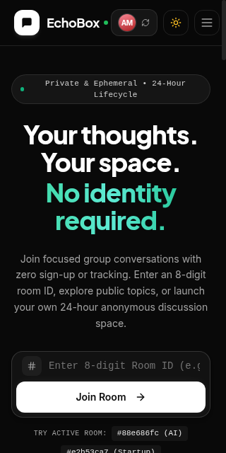 | 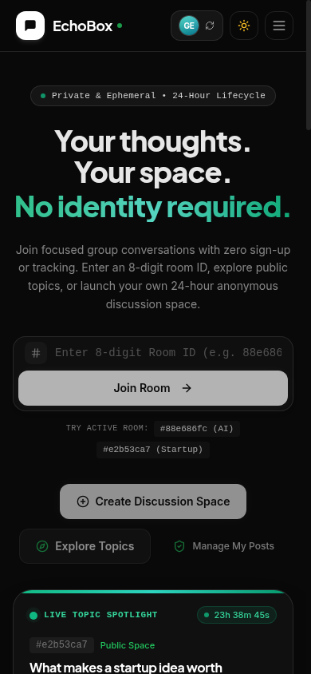 | 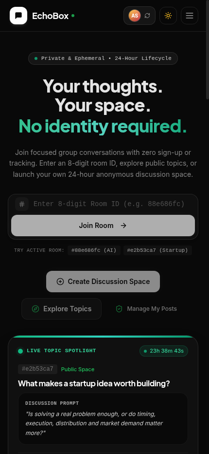 |

| Mobile Anonymous Chat Interface |
| :---: |
| 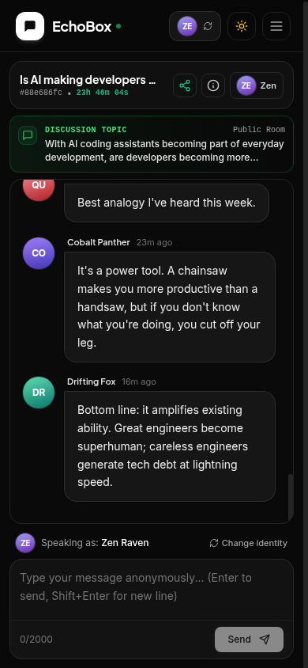 |

### 2.2 Tablet Viewports (768px–1024px)
*Tailored responsive composition with balanced hero typography, interactive room entry, and live discussion spotlight.*

| Tablet (768px Portrait) | Tablet (820px iPad Air) | Tablet (1024px Landscape) |
| :---: | :---: | :---: |
| 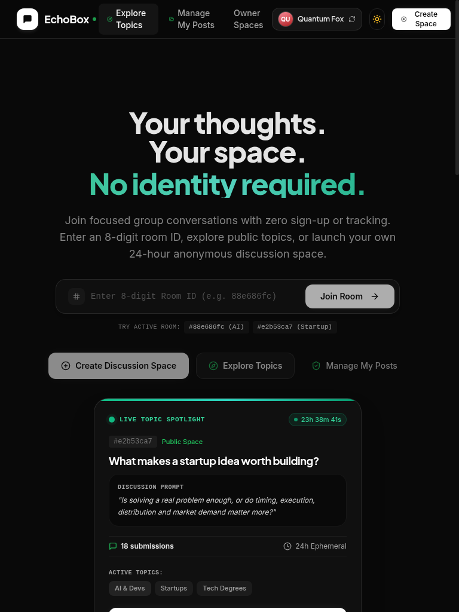 | 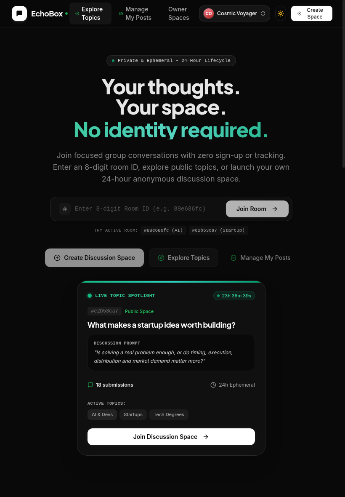 | 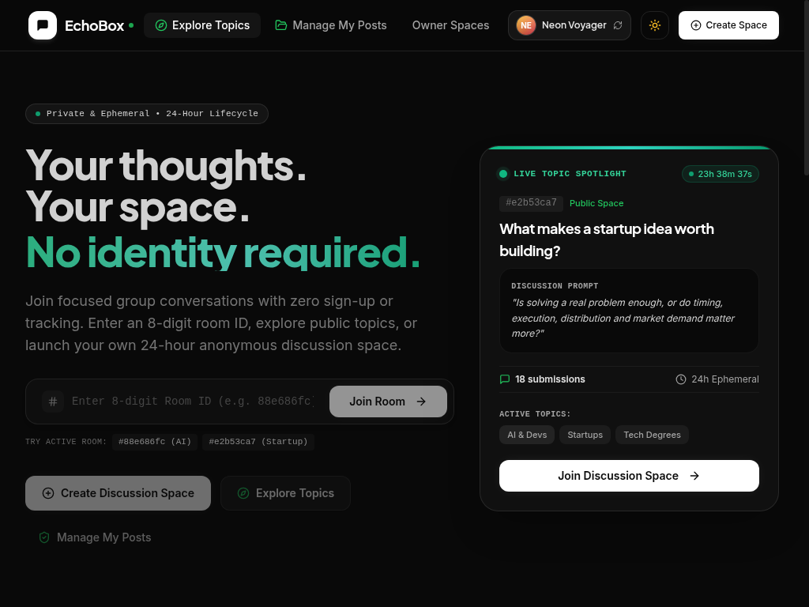 |

### 2.3 Laptop Viewports (1280px–1440px)
*Asymmetric 3-column editorial layout: Left dialogue deck with authentic peer perspectives, center conversion anchor with redesigned room ID input, right live topic spotlight.*

| Laptop (1280px Compact) | Laptop (1440px Desktop) |
| :---: | :---: |
| 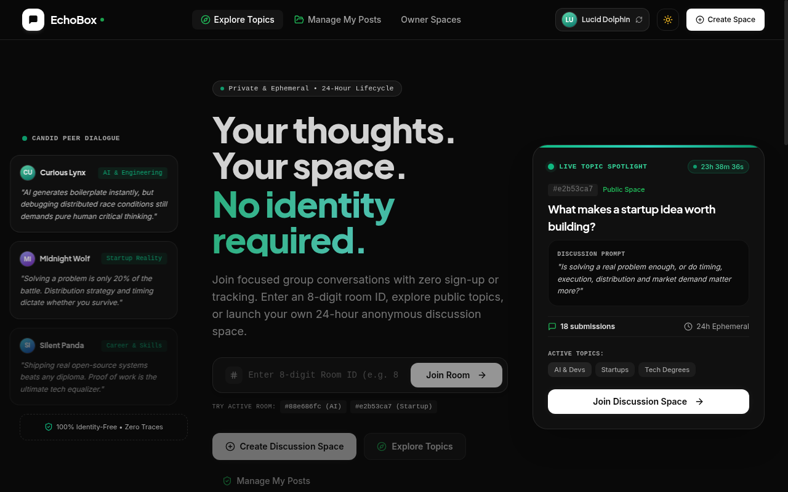 | 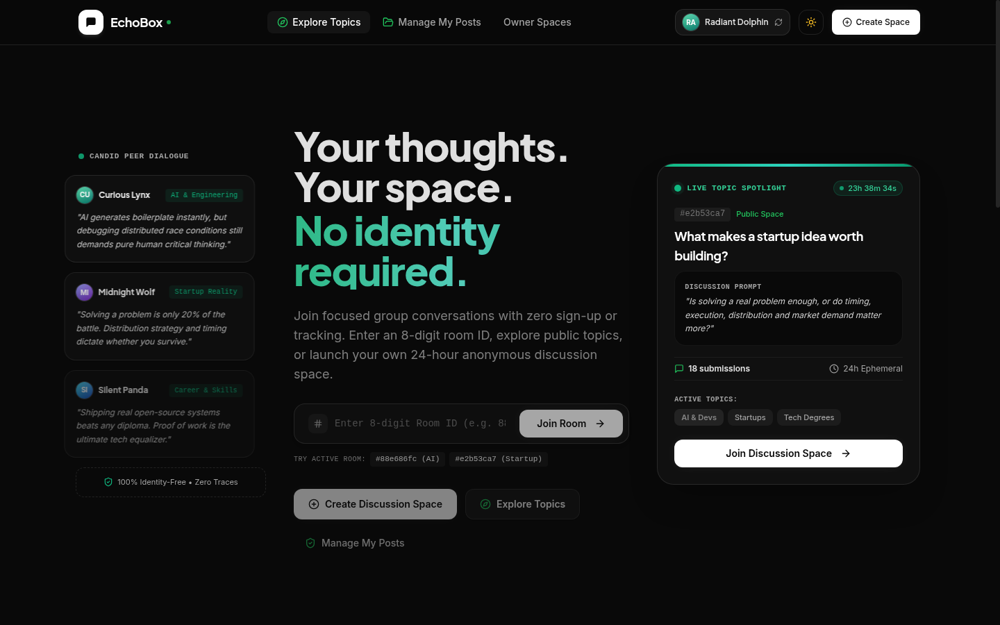 |

### 2.4 Large Desktop Viewports (1600px–1920px+)
*Balanced ultrawide layout with restrained max-width constraints, ambient lighting depth, and full-resolution discussion cards.*

| Desktop (1600px Widescreen) | Desktop (1920px Ultrawide) |
| :---: | :---: |
| 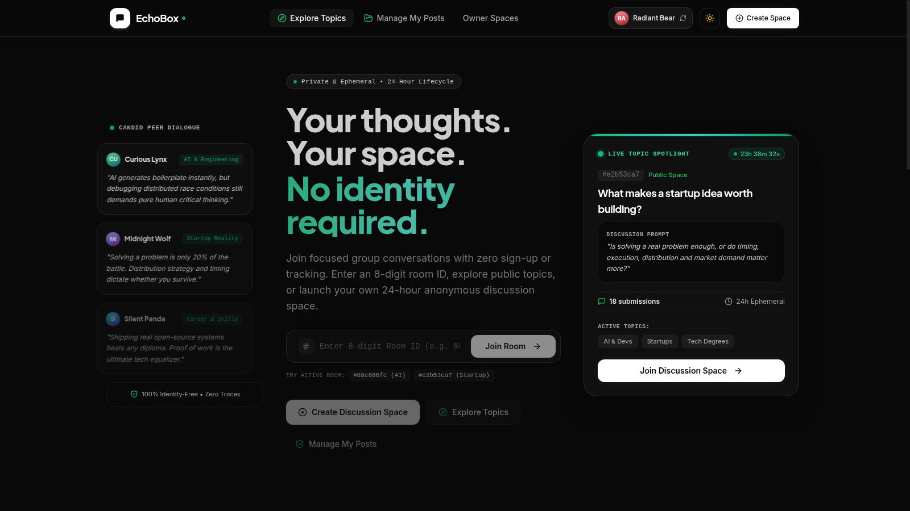 | 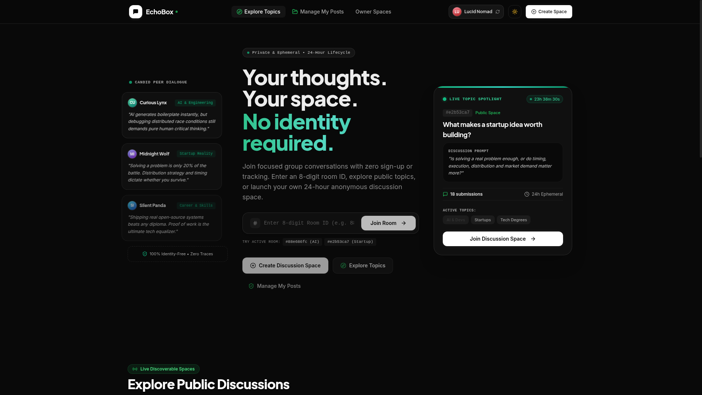 |

### 2.5 Product Core & Discovery
*Real-time discovery feed showcasing the 3 seeded sample topics with live participation metrics, search filtering, and 3-column anonymous chat room.*

| Public Room Discovery | Anonymous Chat Stream |
| :---: | :---: |
|  | 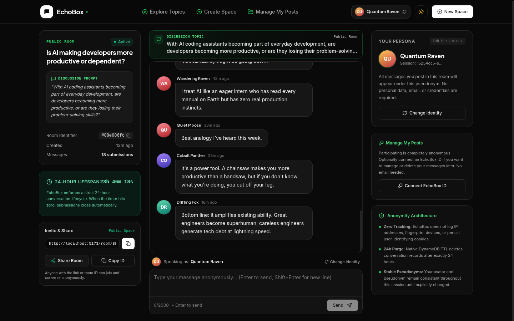 |

### 2.6 Manage My Posts & Owner Authentication

| Manage My Posts Dashboard | Owner Authentication |
| :---: | :---: |
| 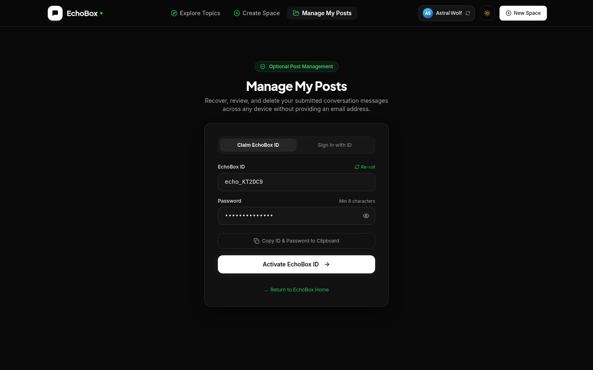 | 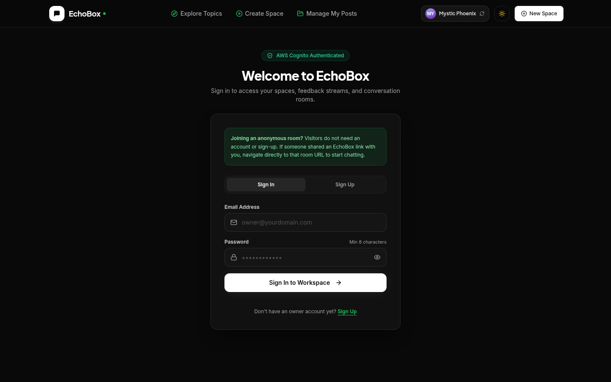 |
| :---: | :---: |
|  |  |

---

## 3. Technology Stack

- **Frontend Core**: React 18 + Vite
- **Language**: TypeScript 5.6 (strict mode)
- **Styling**: Tailwind CSS + Custom Design Tokens (`#090909` OLED dark background, `#22c55e` emerald accents)
- **Animation & Motion**: Framer Motion
- **Icons**: Lucide React
- **Notifications**: Sonner
- **Design Tokens**: Google Labs `DESIGN.md` specification
- **Cloud Infrastructure**:
  - **API Gateway**: Amazon API Gateway HTTP API (`bnbpmiljw9`) with throttling & CORS
  - **Compute**: AWS Lambda (Python 3.14 runtime, 128MB memory, 3s timeout)
  - **Database**: Amazon DynamoDB (`EchoBox` single-table design with native TTL)
  - **Authentication**: Dual Amazon Cognito User Pools (Email-based & Pure Username-based)

---

## 4. System Architecture

```
                                    +-----------------------------------------+
                                    |         EchoBox React Frontend          |
                                    |      (Vite + TypeScript + Tailwind)     |
                                    +--------------------+--------------------+
                                                         |
                                  HTTPS POST / (RPC)     | JWT Auth (Bearer)
                                                         v
                                    +-----------------------------------------+
                                    |     Amazon API Gateway (HTTP API)       |
                                    |  - Rate Throttling: 50 req/s, burst 100 |
                                    |  - CORS: Handled & Strict               |
                                    +--------------------+--------------------+
                                                         |
                                                         v
                                    +-----------------------------------------+
                                    |         AWS Lambda Backend              |
                                    |      Function: echobox-backend          |
                                    |      Runtime: Python 3.14 (128MB)       |
                                    +---------+-------------------+-----------+
                                              |                   |
                     Token Verification       |                   | CRUD & Queries
                                              v                   v
                    +---------------------------+       +---------------------+
                    | Dual Amazon Cognito Pools |       |   Amazon DynamoDB   |
                    | 1. Owner Workspace Pool   |       |  Table: EchoBox     |
                    | 2. EchoBox Identity Pool  |       |  TTL: expires_at    |
                    +---------------------------+       +---------------------+
```

---

## 5. Dual Amazon Cognito Authentication Architecture

EchoBox provides a privacy-first identity boundary by separating workspace owners from anonymous post authors:

| Metric | Workspace Pool (Room Owners) | Identity Pool (Manage My Posts) |
| :--- | :--- | :--- |
| **User Pool ID** | `ap-south-1_NfCww8cVp` | `ap-south-1_vRfOd670T` |
| **App Client ID** | `sctqr0h0042caou4p0tk5s4b8` | `pg5flhrd2r35kp3bn1js2k2hg` |
| **Sign-In Method** | Email + Password | Pure Username (`echo_...`) |
| **Email Required?** | Yes | **NO (100% Privacy)** |
| **PreSignUp Trigger** | `echobox-cognito-pre-signup` | `echobox-cognito-pre-signup` (auto-confirms) |
| **Use Case** | Creating rooms, owner dashboard, close/reopen | Claiming submitted messages for cross-device deletion |

---

## 6. DynamoDB Single-Table Patterns

The application uses Amazon DynamoDB with single-table design principles:

| Entity / Pattern | Partition Key (`PK`) | Sort Key (`SK`) | Description |
| :--- | :--- | :--- | :--- |
| **Room Metadata** | `ROOM#<room_id>` | `METADATA` | Holds `room_name`, `room_description`, `visibility`, `status`, `expires_at`, `owner_id`. |
| **Conversation Message** | `ROOM#<room_id>` | `FEEDBACK#<feedback_id>` | Holds `message`, `display_name`, `anonymous_session_id`, `author_id`, `created_at`, `expires_at`. |
| **Public Room Discovery** | `DISCOVERY#PUBLIC` | `ROOM#<room_id>` | Inverted partition allowing single-query retrieval of public rooms without table scans. |
| **User Post Index** | `USERPOSTS#<user_sub>` | `MSG#<room_id>#<feedback_id>` | Maps author's Cognito `sub` to submitted messages for instant retrieval and deletion in `/my-posts`. |
| **Owner Room Index** | `OWNER#<owner_sub>` | `ROOM#<room_id>` | Maps owner `sub` to created rooms for isolated workspace management. |

---

## 7. Lambda API Action Matrix (POST `/`)

All API interactions run over a unified HTTPS POST RPC endpoint:

| Action | Auth | Security & Scope | Description |
| :--- | :--- | :--- | :--- |
| `discover_rooms` | Public | Read-only | Returns active, unexpired public rooms with message counts. |
| `search_rooms` | Public | Read-only | Matches query `q` against public room name & discussion prompt. |
| `get_room` | Public | Read-only | Retrieves room details, prompt, visibility, status, and message count. |
| `submit_feedback` | Optional JWT | Write | Submits message (1–2000 chars). Associates author `sub` if token present. Rejects closed or expired rooms. |
| `get_feedback` | Public / Owner | Mixed | Returns active room conversation. Owner mode validates `owner_id == caller["sub"]`. |
| `get_my_posts` | **EchoBox ID JWT** | Author-only | Retrieves all messages submitted by the caller across rooms. |
| `delete_my_post` | **EchoBox ID JWT** | Author-only | Deletes author's own message. Rejects unauthorized deletions with HTTP 403 Forbidden. |
| `create_room` | Optional JWT | Write | Creates room with name, discussion question, visibility (`public` \| `private`), and 24h TTL. |
| `get_owner_rooms` | **Owner JWT** | Owner-only | Retrieves all rooms created by authenticated owner. Strict multi-tenant isolation. |
| `close_room` | **Owner JWT** | Owner-only | Disables new submissions for a room. |
| `reopen_room` | **Owner JWT** | Owner-only | Reopens a closed room if 24-hour lifetime has not expired. |
| `delete_feedback` | **Owner JWT** | Owner-only | Deletes any message inside owner's room. |

---

## 8. 24-Hour Lifecycle & DynamoDB TTL Mechanics

EchoBox implements a resilient two-tier expiration architecture:

1. **Immediate Application Enforcement**:
   - Every room and message stores an `expires_at` Unix epoch timestamp calculated at creation (`now + 86400` seconds).
   - Upon receiving any request, the backend Lambda checks `now_epoch >= expires_at`.
   - Any submission to an expired room is immediately rejected with an HTTP `410 Gone` error.
   - Any retrieval filters out expired messages in real time.
2. **DynamoDB Native TTL**:
   - Amazon DynamoDB native Time to Live (TTL) is **ENABLED** on the `expires_at` attribute for the `EchoBox` table.
   - DynamoDB automatically detects expired records and deletes them asynchronously in the background at zero read/write capacity unit (RCU/WCU) cost within 24–48 hours of expiration.

---

## 9. Rate Limiting & Abuse Protection

1. **Request Body Size Limit**: Lambda rejects payloads larger than 64KB with HTTP 413.
2. **Message Validation**: Messages must be 1–2000 characters. Empty or whitespace-only submissions are rejected with HTTP 400.
3. **Submission Cooldown**: Client-side chat composer enforces a 2-second cooldown between submissions to prevent rapid accidental double-posts or client flood.
4. **API Gateway Throttling**: Default stage throttled to 50 requests/sec with burst capacity of 100 requests to safeguard against DDoS attacks.
5. **No Credential Leaks**: Stack traces, database keys, and internal exceptions are trapped and logged server-side, returning generic error codes to clients.

---

## 10. AWS Free Tier Cost Protection

EchoBox is engineered to operate strictly within the AWS Free Tier:

- **DynamoDB**: `PAY_PER_REQUEST` On-Demand capacity (under 25 GB storage and well within free monthly read/write quotas).
- **Lambda**: Configured with 128MB memory and 3-second timeout (3.2 million seconds free per month).
- **API Gateway**: HTTP API protocol (lower cost than REST API; 1 million free calls per month).
- **Cognito**: Dual user pools (Cognito offers 50,000 monthly active users (MAUs) free tier for User Pools).
- **No Paid Services**: Zero EC2 instances, zero NAT gateways, zero RDS databases, zero provisioned IOPS.

---

## 11. Local Setup & Build

### Prerequisites
- Node.js 18+ or Node.js 20+
- npm 9+

### Installation & Development
```bash
# 1. Clone repository
git clone https://github.com/sohan10012/EchoBox.git
cd EchoBox

# 2. Install dependencies
npm install

# 3. Create local environment configuration
cp .env.example .env
# Fill in your AWS API Gateway and Cognito values

# 4. Start local development server
npm run dev
```

### Production Build & Linting
```bash
# Run TypeScript check and Vite production bundle
npm run build

# Lint Google DESIGN.md tokens
npx -y @google/design.md lint DESIGN.md
```

---

## 12. Vercel Deployment Configuration

When deploying the frontend to Vercel, configure the following environment variables in the Vercel Project Settings:

| Environment Variable | Recommended Value | Description |
| :--- | :--- | :--- |
| `VITE_API_BASE_URL` | `https://bnbpmiljw9.execute-api.ap-south-1.amazonaws.com` | API Gateway Base URL |
| `VITE_AWS_REGION` | `ap-south-1` | AWS Region (Mumbai) |
| `VITE_COGNITO_USER_POOL_ID` | `ap-south-1_NfCww8cVp` | Workspace User Pool (Owners) |
| `VITE_COGNITO_CLIENT_ID` | `sctqr0h0042caou4p0tk5s4b8` | Workspace Client ID |
| `VITE_COGNITO_IDENTITY_USER_POOL_ID` | `ap-south-1_vRfOd670T` | EchoBox Identity Pool (Pure Username) |
| `VITE_COGNITO_IDENTITY_CLIENT_ID` | `pg5flhrd2r35kp3bn1js2k2hg` | EchoBox Identity Client ID |

*Note: Single-page application (SPA) client-side routing is handled automatically via `vercel.json` rewrites.*

---

## 13. License

MIT © EchoBox Inc.
